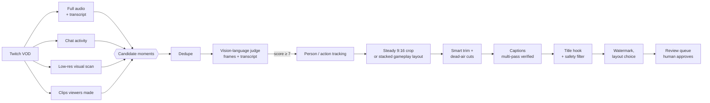

# AI Video Clipping Pipeline

An end-to-end system that watches long Twitch livestreams (4–12 hours) and turns the best moments into finished vertical clips: it finds candidate moments, has a vision-language model judge them, tracks the right person for a 9:16 crop, trims dead air, burns in verified captions and a title, and queues the result for human approval.

It runs unattended every night on a single laptop over a list of streamers. Nothing is posted without a person approving it.

> **Status:** working and in daily use on my own clip account; actively developed. Not a polished product — see [Limitations](#limitations).

---

## What it does



| Stage | How |
|---|---|
| **Candidate discovery** (4 independent signals) | transcript windows scored by an LLM; chat bursts measured as *unique active chatters* per 15 s (far more robust than raw message rate); a low-resolution visual scan with a contact-sheet filter; and the clips Twitch viewers themselves made (Helix API) |
| **Judging** | Claude (vision) sees 10 timestamped frames + the transcript of each ~70 s candidate and scores the best 15–45 s inside it; approval threshold 7/10 |
| **Tracking** | YOLO + ByteTrack person tracks, stitched into identities with face embeddings (InsightFace / dlib) and OSNet re-identification; a separate "follow the action" tracker for broadcast-style content |
| **Framing** | offline-planned crop: position and zoom are smoothed over ~1 s with dead-bands, unreliable shots fall back to a wide view, and a facecam over gameplay gets a stacked layout (gameplay top, enlarged facecam bottom) |
| **Editing** | smart trim to the best stretch, internal cuts that remove silence inside a clip |
| **Captions** | Whisper (Groq) transcription, multi-pass resolution of uncertain words, a quality gate that sends doubtful clips to review, face-aware placement, and uncertain short lines left blank instead of guessed |
| **Titles** | LLM-written hook with a code-level safety filter (blocks mocking physical traits, slurs, unverified accusations) and an automatic rewrite loop |
| **Operations** | resumable stages (every stage skips work already done), nightly scheduled batches, disk-space and API-credit guards, automatic cleanup, per-VOD reports, a human review queue with a daily posting cap |

---

## Results so far

All numbers below come from real runs on real VODs unless marked *simulated*. Sample sizes are small; treat them as evidence of direction, not benchmarks.

**Finding the moments people actually clip.** I used the clips Twitch viewers made as ground truth (top 10 per VOD by views):

| | Before (120 viewer clips, 12 VODs) | After adding viewer-clip candidates + a revised judge (30 clips, 3 new VODs) |
|---|---|---|
| Found and approved | 4 % | **13 %** |
| Found, judge rejected | 21 % | 50 % |
| Never found | 72 % | **37 %** |

The most-viewed moment in one stream (≈28k views) went from undiscoverable to found-and-approved. The bottleneck has now moved from *detection* to *judging*.

**Changing the judge without loosening it.** A revised judge prompt (score the best 15–45 s of the raw window; count spoken punchlines and reactions as payoffs) was A/B-tested on 46 clips I had labelled by hand, with both prompts given identical frames and transcripts:

| My label | Passing, old prompt | Passing, new prompt |
|---|---|---|
| Weak (18) | 0 | **0** |
| Borderline (25) | 3 | 5 |
| Strong (3) | 1 | 2 |
| Popular viewer-clip moments (8) | 0 | 3 |

It was only switched on because weak clips stayed at zero.

**Model choice.** A cheaper model tier reached ~24 % of the stronger model's recall on clip-worthiness, so the stronger model is used for judging.

**Tracking.** Raw person tracking fragmented badly on busy streams (68 track IDs for a handful of people on one clip); clustering by face similarity merged them into 8 identities. On the hardest single-person test clip the tracker holds the crop still on ~20 % of frames rather than guessing, with **no wrong-person locks** — holding still was a deliberate choice over jumping to a bystander.

**Steadier framing** (*simulated* 40 s tracks, previous renderer → current):

| Scenario | Frames with zoom moving | Crop ↔ letterbox switches |
|---|---|---|
| Fight, tracker frequently lost | 51 % → 0 % | 21 → 0 |
| Talking, rarely lost | 56 % → 6 % | 33 → 3 |

---

## Engineering problems worth reading about

Short write-ups in [`docs/ENGINEERING_NOTES.md`](docs/ENGINEERING_NOTES.md), including:

- why *unique chatters* beat message counts as a hype signal
- a transcription error ("Neon" → "young Navi") that hid the biggest moment of a stream, and what that taught about single-signal detection
- why the judge was rejecting popular moments (it scored the raw 70 s window and only valued visual payoffs) and how that was fixed and verified
- muted VOD sections making the speech model invent "Thank you." every 30 s — detected by loudness and filtered
- a crop that "breathed" because zoom smoothing was tuned per frame (twice as fast on 60 fps streams) and flipped between two render modes at a hard threshold
- one malformed model reply crashing a 7-hour job; a cleanup script deleting candidates that had never been judged
- browsers showing clips as "corrupt" because some encoders inherited a 4:4:4 pixel format

Architecture details: [`docs/ARCHITECTURE.md`](docs/ARCHITECTURE.md) · Evaluation method: [`docs/EVALUATION.md`](docs/EVALUATION.md)

---

## Running it

The code in [`src/`](src/) is the pipeline as it runs today (a flat set of scripts that call each other). It expects:

- macOS or Linux, Python 3.11+, `ffmpeg`/`ffprobe` on the PATH
- `pip install -r requirements.txt`
- environment variables `ANTHROPIC_API_KEY`, `GROQ_API_KEY`, and `TWITCH_CLIENT_ID` / `TWITCH_CLIENT_SECRET` (never committed)
- a one-time face reference per streamer you want to follow: `add_streamer.py` builds it mostly automatically from a few VOD snippets and asks you to confirm the face once. References are biometric data and are **not** included here

```bash
cd src
python3 add_streamer.py --channel <twitch_channel>       # one-time per streamer
python3 run_pipeline.py --vod-id <id> --stream-start <iso-time> \
    --output-dir <id>_final_review --channel <channel> \
    --tracker tracklets --face-backend insight --finish-verticals --internal-cuts --smart-trim
python3 batch_run.py streamers.txt --layout auto       # every streamer's newest VOD
python3 post_queue.py                                   # review page; nothing is uploaded
```

No video, transcripts, face data or model weights are included. Example outputs are not published because the footage belongs to the streamers.

---

## Limitations

- One VOD takes roughly 1–2.5 hours on a laptop CPU; jobs run one at a time.
- New streamers need a one-time face reference; fully automatic identification of unknown streamers is not built yet.
- The judge still rejects about half of the moments viewers clipped. Some of those are correct rejections (inside jokes, content unsuitable for TikTok); some are not.
- Results above come from a few dozen labelled clips and a handful of streams.
- The scripts grew iteratively and are not yet organised as a package.

## How this was built

I designed and directed this project and ran it end to end: choosing the approach for each stage, running every experiment on real VODs, reviewing outputs frame by frame, labelling the evaluation clips, and deciding what to keep. Most of the code was written with AI coding assistants (mainly Claude) working from my requirements and from evidence I collected; I reviewed, tested and integrated each change. The [engineering notes](docs/ENGINEERING_NOTES.md) describe the reasoning behind the main decisions.

— Armaan Nasri
