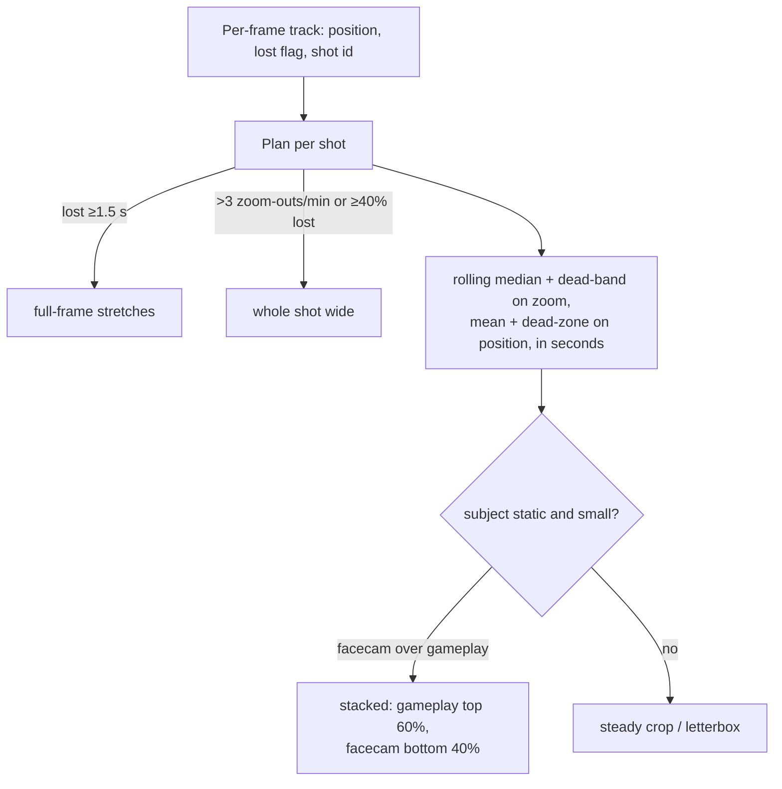

# Architecture

The pipeline is a set of Python scripts orchestrated by `run_pipeline.py` (one VOD) and `batch_run.py` (many streamers). Every stage writes its output to disk and **skips itself if that output already exists**, so an interrupted 7-hour job resumes where it stopped, and expensive results (detections, transcripts, judgments) are never recomputed. `--force-<stage>` reruns one stage.

## Stages (run_pipeline.py)

| # | Stage | Script(s) | Output |
|---|---|---|---|
| 1 | Fetch full VOD audio (skipped if the transcript exists) | `twitch_adapter.py`, `run_pipeline.py` | `<vod>_full_audio.mp4` |
| 2 | Transcribe (Whisper large-v3-turbo via Groq; muted-audio and filler detection) | `transcribe_groq.py` | `<vod>_transcript.json` |
| 3 | Score sliding transcript windows (LLM; must name a concrete payoff line to score 7+) | `score_transcript_clips.py` | `<vod>_transcript_scores.json` |
| 4 | Merge and silence-check candidates | `run_pipeline.py` | `<vod>_final.json` |
| 5 | Chat-burst candidates (unique chatters / 15 s vs local median) | `run_pipeline.py` | `chat_*.mp4` |
| 6 | Visual discovery: low-res proxy scan → event clustering → contact-sheet filter (vision LLM) | `visual_discovery_stage.py`, `visual_contactsheet_filter.py`, `cluster_visual_events.py` | `visualdisc_*.mp4` |
| 7 | Viewer-clip candidates (Helix `/clips`, top N by views) | `viewer_candidates.py` | `viewer_*.mp4` |
| 8 | Dedupe (same moment within 30 s) | `dedupe_candidates.py` | `_duplicates/` |
| 9 | Judge: 10 frames + transcript → JSON score, best stretch, caption idea | `visual_clip_judge.py` | `visual_judgments/*.json` |
| 10 | Crop: presence check → streamer tracker or action tracker → v4 renderer | `track_by_tracklets.py`, `track_action.py`, `render_vertical_crop_v4.py` | `vertical/*_vertical.mp4` |
| 11 | Finish: dead-air cuts, smart trim, captions, hook, watermark | `finish_clip.py`, `internal_cuts.py`, `smart_trim.py`, `render_resolved_captions.py`, `generate_clip_hook.py`, `render_clip_hook.py`, `render_watermark.py`, `finalize_clip.py` | `production_ready/*_final.mp4` |
| 12 | Report | `pipeline_report.py` | `_pipeline_report.txt` |

After the pipeline, `apply_layout.py` and `layout_decide.py` classify each approved clip as person-, action- or screen-focused, and render a split-screen version where it fits (`split_preview.py`). Both versions are kept, and the recommended one is marked.

## Crop renderer (v4)

## Operations

- **batch_run.py:** picks each streamer's newest finished VOD (skips live streams and over-long VODs), checks API credits and free disk before every VOD, retries at a lower quality if 1080p is unavailable, cleans up after each VOD (`free_space.py`), and writes a batch report with links to approved clips.
- **install_nightly.py:** a launchd job runs the batch daily, then refreshes the review queue.
- **post_queue.py:** collects approved clips, writes captions (hook + streamer credit + hashtags), and builds a local review page (approve / skip / edit caption). It prepares at most N posts per day. It never uploads anything.
- **clip_settings.py:** on/off switches for captions, hook, watermark, the steady crop and the gameplay layout.
- **refinish_clips.py:** re-runs only crop and finishing for queued clips after a rendering improvement, reusing all cached analysis.

## External services

| Service | Used for |
|---|---|
| Anthropic API (Claude) | transcript scoring, visual judge, contact-sheet filter, layout classification, hooks |
| Groq (Whisper) | transcription |
| Twitch (HLS manifests, Helix API) | VOD audio and segments, VOD metadata, viewer clips |
